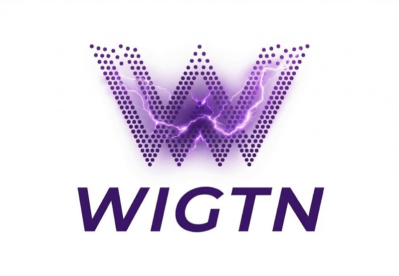

  

<h3 align="center">Your partner for enterprise AI transformation.</h3>

  <em>We turn frontier AI research into production systems enterprises actually run.</em>

  
  
  

---

## Who we are

**WIGTN** is an independent AI team in Korea. We start from a client's real problems and bring AI into the way their team already works: from the first idea to a system running in production. We study AI in the open, publish the proof, and turn that work into tools enterprises can rely on.

## What we do

Three teams:

- **Solutions**: AX consulting and system integration for enterprises. Projects with SK hynix (through Braincrew), Braincrew and Mind AI.
- **Product**: open-source tools we build and use ourselves: WIGSS and the WIGTN plugins for Claude Code and Codex.
- **Research (R&D)**: peer-reviewed research on LLMs, their evaluation, and speech (STT and TTS), at ACL, EMNLP and NeurIPS.

## Proof

| Area | Highlight |
|------|-----------|
| Research | **WIGVO** accepted to **ACL 2026** (System Demonstrations), real-time phone-call translation |
| Models | **WigtnOCR** ranked **#1** on KoGovDoc-Bench, a 2B Korean document parser |
| Awards | **Grand Prize**, Build with TRAE Seoul (ByteDance) · **2nd Place**, Snowflake AI & Data Hackathon Korea |
| Open source | Models, plugins, and tools published on GitHub, Hugging Face, and npm |

### Selected work

| Project | What it is | Links |
|---------|------------|-------|
| **WIGVO** | Real-time bidirectional voice translation over standard phone lines | [Demo](https://www.youtube.com/watch?v=jK1CDOQExLw) · [Code](https://github.com/wigtn/wigvo-v2) |
| **WigtnOCR** | 2B Korean document parser distilled from a 30B teacher | [Model](https://huggingface.co/Wigtn/Qwen3-VL-2B-WigtnOCR) · [Code](https://github.com/wigtn/wigtnOCR-v1) |
| **WIGSS** | Drag UI in the browser and watch the source rewrite itself | [npm](https://npmjs.com/package/wigss) · [Code](https://github.com/wigtn/wigss) |
| **WIGTN Coding** | A Claude Code plugin ecosystem: 12 agents, 3 skills, 17 design styles | [Code](https://github.com/wigtn/wigtn-plugins-with-claude-code) |
| **TimeLens** | Real-time AI museum curator via Gemini Live | [Live](https://timelens-852253134165.asia-northeast3.run.app/) · [Code](https://github.com/wigtn/wigtn-timelens) |

## Partners

Braincrew · Mind AI · Arustay

## Contact

PoC, joint research, or a production system your team can run. Proposals are always welcome.

- **Web**: [wigtn.com](https://wigtn.com)
- **Email**: [contact@wigtn.com](mailto:contact@wigtn.com)

---

  © 2025–2026 WIGTN. Individual projects are licensed as indicated in their respective repositories.

